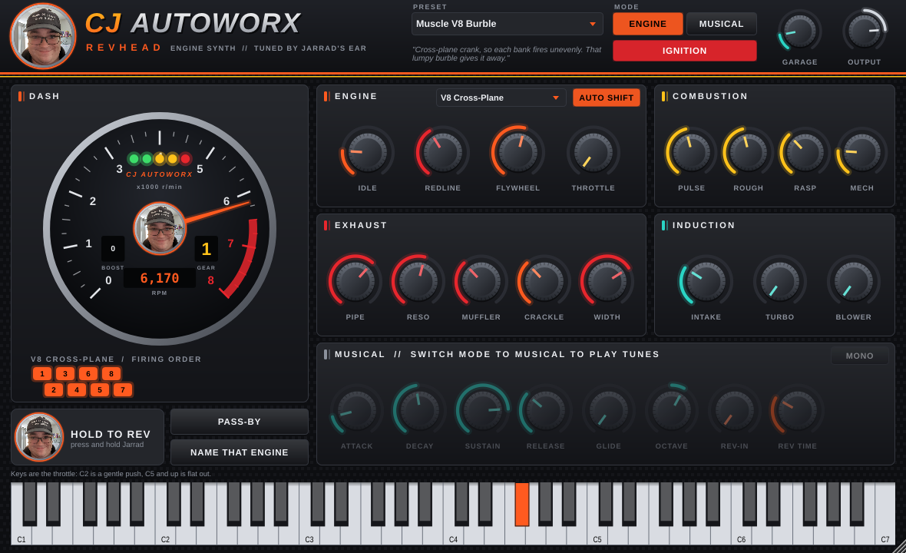
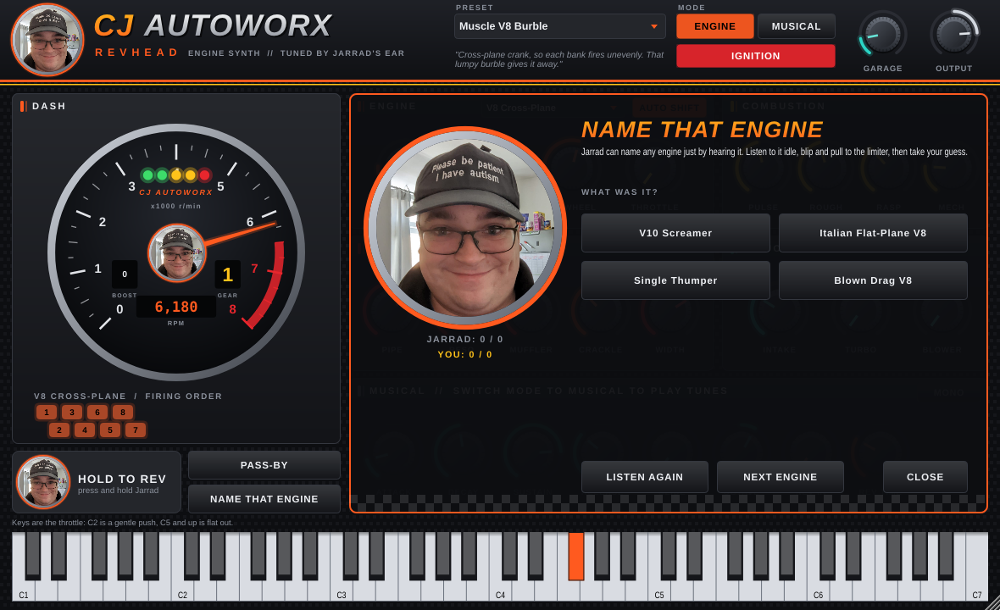

# CJ Autoworx RevHead


An engine synthesizer from **CJ Autoworx**, as a VST3 for your DAW and as an Android app. It makes car, bike and diesel engine sounds
from scratch. Flip it into **MUSICAL** mode and the keyboard sets the engine's firing frequency,
so you can play basslines, leads and pads made of engines.

The face of CJ Autoworx is Jarrad. He can name almost any engine just by hearing it, and his
face is all over the plugin: the logo, the hub of the rev counter, the rev button you hold down,
and the host of the **Name That Engine** quiz.



## How it makes the sound

Nothing is sampled. Every engine is modelled from how it actually fires:

- **Cylinder layouts with real firing orders**: Single, 45° V-Twin, Inline-3, Inline-4,
  Flat-4 Boxer, Inline-5, Inline-6, V6, cross-plane V8, flat-plane V8, V10, V12, 2-rotor
  Rotary and a Diesel I4. Each cylinder fires at its crank angle into one of two exhaust banks,
  which become the left and right channels. That's why a cross-plane V8 *burbles* (each bank
  fires unevenly) while a flat-plane V8 *screams* (the banks take turns), and why a Subaru-style
  boxer rumbles (unequal-length headers).
- **Combustion**: each bang is a pressure pulse whose length follows the exhaust port open
  time. **ROUGH** adds misfire-ish variation between cylinders and cycles, and **RASP** adds
  the sharp crack and distortion of a loud exhaust. **MECH** adds valvetrain tick, or diesel
  knock on the diesel layout.
- **Exhaust**: a waveguide pipe (**PIPE** length, **RESO**nance), a **MUFFLER** that opens up
  with the throttle, and **CRACKLE**: overrun pops and bangs when you lift off at high revs
  or bounce off the limiter.
- **Induction**: **INTAKE** roar, a **TURBO** that spools up with lag, whines and fires its
  blow-off valve when you lift, and a supercharger **BLOWER** whine that tracks the revs.
- **Engine physics** (ENGINE mode): a flywheel-weighted RPM model with a real ignition-cut rev
  limiter, a starter motor when you switch on the **IGNITION**, and **AUTO SHIFT**: hold the
  throttle and it changes up through six gears (with a shift cut), then blips down as you coast.
- **PASS-BY**: the car drives past you at 100 km/h, with Doppler shift, distance and panning.

## Two modes

**ENGINE**: the plugin is a car. Any held key is the accelerator. Higher keys press it harder:
C2 is a gentle push and C5 and up is flat out. The **THROTTLE** knob and the mod wheel work
too, so you can draw a rev in an automation clip. You can also press and hold Jarrad's face
(**HOLD TO REV**).

**MUSICAL**: every note is an engine whose firing frequency is that note's pitch, so an A3
on a V8 is the engine at 3,300 rpm and it plays perfectly in tune. Each note has its own engine,
with up to 8 voices or **MONO** with glide. **REV-IN** makes each note rev up into its pitch.
Velocity is throttle, so harder notes are brighter, and when you let go the overrun pops
come out. Set **ROUGH** to zero for a perfectly even, in-tune engine, or turn it up for burble
and lumpy sub-harmonics.

## Name That Engine

Click **NAME THAT ENGINE**. A mystery engine starts, idles, blips and pulls to the limiter.
The cylinder lights are hidden, so you have to use your ears. Pick one of four answers. Jarrad
explains the giveaway: the burble of a cross-plane V8, the off-beat of a five-pot, the
potato-potato of a V-twin. He's always on full marks. You can try to keep up.



## Presets

| Engines (the quiz pool) | Musical |
|---|---|
| Muscle V8 Burble, Blown Drag V8, Italian Flat-Plane V8, Rally Boxer Turbo, Five-Pot Quattro, Straight-Six Turbo, Rotary Brap, Big Twin Cruiser, V12 Grand Tourer, V10 Screamer, Hot Hatch Triple, Diesel Workhorse, V6 Daily, Single Thumper | Burble Bass, Redline Lead, Turbo Pad, Rotary Pluck, V12 Choir, Diesel Sub |

## Using it in FL Studio

1. Download **CJAutoworx-RevHead-Windows-VST3** from the latest *Build* run in GitHub Actions
   (or from a release), and unzip it.
2. Copy the `CJ Autoworx RevHead.vst3` folder to `C:\Program Files\Common Files\VST3\`.
3. In FL Studio, open *Options → Manage plugins* and click *Find plugins*. Then star
   **CJ Autoworx RevHead** so it shows up in the Channel Rack.

Tips:

- For a car going through the gears, pick **Muscle V8 Burble** in ENGINE mode, turn on
  AUTO SHIFT and hold a high note for a few bars. Let go for the crackle.
- For engine noise under a track, automate **THROTTLE** in ENGINE mode and leave the piano roll empty.
- For an 808-style engine bass, try **Burble Bass** or **Diesel Sub**. Set ROUGH to 0 for clean
  tuning, or turn it up to 40% for burble.

## On Android

RevHead also runs as an Android app. Android has no VST hosts, so it's the standalone
synth, full screen in landscape, with the on-screen keyboard and touch controls. Hold Jarrad
to rev, drag the knobs, and play the keys.

1. Download **CJAutoworx-RevHead-Android-APK** from the latest *Build* run in GitHub Actions.
2. Copy `CJAutoworx-RevHead.apk` to the phone or tablet and open it. You may need to allow
   *Install unknown apps* for your file manager. The APK is signed with a standard debug key,
   so it's fine for sideloading but not for the Play Store.

A USB MIDI keyboard should work too: plug it in and pick it under *Options* in the app.

To build it yourself, you need Java 17 and the Android SDK (`ANDROID_HOME` set). Then run:

```sh
CJAutoworx/Android/build-android.sh
```

JUCE's CMake API can't target Android, so the script fetches JUCE, builds the Projucer and
uses it to generate an Android Studio project from `CJAutoworx/Android/CJAutoworx.jucer`.
It then builds the APK with Gradle. You can also open
`CJAutoworx/Android/Builds/Android` in Android Studio once the script has generated it.

## Building from source

It builds with the rest of the repository (JUCE is downloaded automatically):

```sh
cmake -S . -B build -DCMAKE_BUILD_TYPE=Release
cmake --build build --config Release --target CJAutoworx_VST3
```

The plugin is written to `build/CJAutoworx/CJAutoworx_artefacts/Release/VST3/`. There is
also a `CJAutoworx_Standalone` target with Jarrad as its app icon.

### Render test

An offline test drives every engine through a start, a blip, a full pull and a lift-off. It
also plays the musical presets, checks the pitch tracking (A3 = 220 Hz), the rev limiter, the
gearbox, the ignition, pass-by and the quiz, round-trips the state, and saves screenshots of
the editor:

```sh
cmake -S . -B build-test -DCJ_AUTOWORX_BUILD_TESTS=ON
cmake --build build-test --target CJAutoworxRenderTest
./build-test/CJAutoworx/CJAutoworxRenderTest_artefacts/Release/CJAutoworxRenderTest render-out
```
