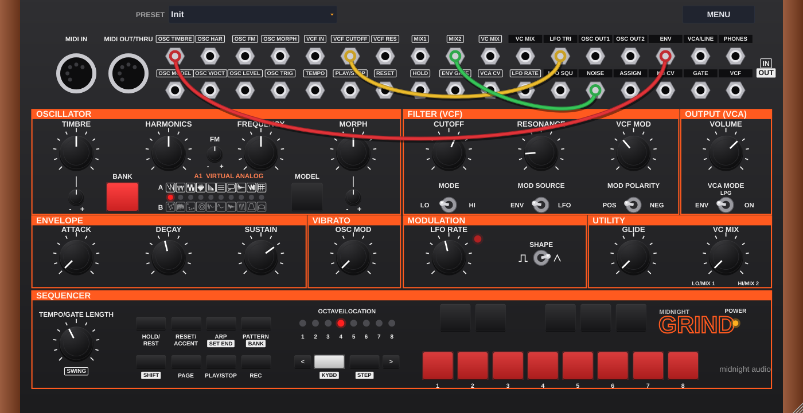

# Midnight Grind

A hybrid semi-modular synth VST3 modelled on the **Behringer GRIND**. It has a 24-engine
digital oscillator, a 24 dB ladder filter, a VCA with an attack/decay envelope, an analog-style
LFO, a 32-step sequencer, an arpeggiator, the 21-input / 13-output patch bay and up to 16 voices of
"Poly Chain".



The GRIND's oscillator is built on Mutable Instruments **Plaits**, and so is this one. The Plaits
engines here are Emilie Gillet's original open-source DSP code (MIT licence), vendored in
`ThirdParty/mutable` and driven the way the Plaits voice drives them: the trigger, the internal
decay envelope, the low-pass gate and the per-engine gain staging all match. Those engines
are therefore the real thing, not an approximation.

## What's in it

### Digital oscillator: 24 engines

| Bank | Engines | Source |
|---|---|---|
| **Synth** | Virtual Analog, Waveshaper, FM, Grains, Additive, Chords, Speech, Karplus, Hypersaw, Wavetable | Plaits |
| **Percussion / noise** | Rain, Noise, Dust, Modal Strings, Bass, Snare, Hi Hat | Plaits |
| | FM Drum, Cowbell, Tom | new (Tom uses the Plaits analog drum resonator) |
| **Extended** | DX7 | Plaits 6-op FM, with the three DX7 patch banks |
| | TD-3 Bassline, Wave Generator, Vox | new |

- **HARMONICS / TIMBRE / MORPH** are the three macro controls; the table in `Source/EngineTable.h`
  lists what each one does per engine. The selected engine's name is shown above the model rows.
- **FM** and the small knobs under **TIMBRE** and **MORPH** are the Plaits attenuverters for the
  OSC FM / OSC TIMBRE / OSC MORPH jacks. With nothing patched into those
  inputs, they apply the oscillator's internal decay envelope, just as on Plaits.
- **OSC DECAY**, **LPG COLOUR** and **PLAITS LPG** (on the MENU's settings page) control the
  Plaits low-pass gate, which can pluck the oscillator on every note.
- **VC MIX** blends OSC OUT1 (the engine's main output) with OSC OUT2 (its AUX variant, listed in
  `Source/EngineTable.h`).
- **FREQUENCY** sets ±3 octaves. Fine tune is on the MENU's settings page.

### Panel
The editor reproduces the GRIND front panel: the same sections, knobs, toggle switches,
BANK / MODEL buttons with the A / B model rows, and the sequencer pads. It scales to any
window size, including a phone screen.

- **Filter (VCF)**: CUTOFF, RESONANCE and VCF MOD, with switches for MODE (LO / HI = low-pass /
  high-pass), MOD SOURCE (ENV / LFO) and MOD POLARITY. The filter is a 2× oversampled 24 dB
  transistor-ladder model that self-oscillates.
- **Output (VCA)**: VOLUME and VCA MODE: ENV, LPG (an envelope-driven low-pass gate) or ON
  (drone, or self-enveloped percussion).
- **Envelope**: ATTACK, DECAY and SUSTAIN (release uses the decay time). **Vibrato**: OSC MOD.
- **Modulation**: LFO RATE with LED, and SHAPE (square / triangle). **Utility**: GLIDE and VC MIX
  (crossfades MIX 1 / MIX 2, normalled to OSC OUT 1 / OSC OUT 2).
- **BANK** steps through A (synth), B (percussion) and C (the 4 extended engines; LEDs turn
  green). **MODEL** steps through the bank, and you can also tap an icon directly.
- **MENU** (top right) opens the full step grid, the arpeggiator patterns and the settings page.
  The settings page holds the controls with no panel space: Plaits LPG, osc decay, LPG colour,
  fine tune, drive, key tracking, Poly Chain voices, MIDI and ASSIGN output.

### Patch bay (21 inputs, 13 outputs)
The jacks follow the hardware exactly. Drag from any jack to another to patch a cable. Drag a
plug off an input to move it, or tap a patched input to unplug it. Every input is normalled,
so a cable replaces the default connection.

- **Inputs**: OSC TIMBRE, OSC HAR, OSC FM, OSC MORPH, VCF IN, VCF CUTOFF, VCF RES, MIX1, MIX2,
  VC MIX, OSC MODEL, OSC V/OCT, OSC LEVEL, OSC TRIG, TEMPO, PLAY/STOP, RESET, HOLD, ENV GATE,
  VCA CV, LFO RATE.
- **Outputs**: VC MIX, LFO TRI, OSC OUT1, OSC OUT2, ENV, VCA/LINE, PHONES, LFO SQU, NOISE,
  ASSIGN, KB CV, GATE, VCF.

Audio outputs patched into VCF IN, MIX1 or MIX2 run at audio rate. For example, NOISE into MIX2
blends noise in with VC MIX.

### Sequencer pads
- **KYBD**: the 8 pads and 5 black keys are a one-octave keyboard. ◀ ▶ change the octave,
  shown on the OCTAVE/LOCATION LEDs.
- **STEP**: the pads are the 8 steps of the current page, and PAGE or ◀ ▶ move through the 4
  pages. Tap a pad to toggle its step. Long-press for its note, accent, slide, tie or ratchet.
- **PLAY/STOP** runs the sequencer. **REC** enables step entry; while recording, HOLD/REST
  inserts a rest and RESET/ACCENT accents the last step.
- **ARP** toggles the arpeggiator, and HOLD latches it. **PATTERN/BANK** selects one of the 64
  patterns.
- **SHIFT** turns the TEMPO knob into SWING, and changes ARP into SET END (the pattern ends at
  the cursor).

### Sequencer and arpeggiator
- **PLAY MODE** offers KEYS, SEQ or ARP.
- **Sequencer**:
  - 32 steps and 64 pattern slots (banks A–H × 8). Each step has a note, gate, accent, slide,
    tie and ratchet (×2–×4).
  - Pattern length is 1–32, the rate goes from 1/4 to 1/32 (triplets included), with gate
    length and swing.
  - **REC** enables step entry: play a note to write it at the cursor. While the pattern runs,
    the keys transpose it.
  - **COPY / PASTE / CLEAR / RANDOM** work on the current pattern.
- **Arpeggiator**: 12 patterns (Up, Down, Up/Down, Down/Up, Up+Down, Played, Random, Converge,
  Diverge, Pinky Up, Thumb Up, Chord), 1–4 octaves, rate, gate and **HOLD** (latch).
- **Timing**: both follow the host transport when it is playing. With the transport stopped,
  they run from their own clock at the TEMPO setting: the arpeggiator whenever keys are held,
  the sequencer when **RUN** is on.

### Voices and MIDI
- **Poly Chain**: 1–16 voices. Each voice is a full oscillator, filter, VCA and envelope.
  With 1 voice, the synth is the mono GRIND, with legato note returns.
- **Voice priority** (Last / Low / High), **MIDI channel** (Omni / 1–16) and **pitch bend
  range** are on the Settings tab. The ASSIGN output can carry velocity, mod wheel, aftertouch,
  accent, S&H or the oscillator envelope.

### Factory presets
There are 23 presets, chosen from the PRESET menu or from FL Studio's preset list:
- Init
- Grind Bass
- Acid Line (TD-3 + sequencer)
- Hypersaw Lead
- DX Keys
- Chord Stabs
- Plaits Pluck
- Karplus Harp
- Modal Bells
- Robot Speech
- Vox Choir
- Wavetable Sweep
- Rain Drone
- Grind Kick
- Snare
- Hats
- FM Drum Perc
- Cowbell
- Tom Fill
- Wave Gen Bass
- FM Growl
- Grain Pad
- Noise Sweep

## How close is it to the hardware?

- **Plaits engines**: bit-for-bit the same algorithms. They run at the module's 48 kHz
  internal rate and are resampled to your session rate. Plaits' 16-bit output clipping is
  kept too.
- **New engines** (FM Drum, Cowbell, Tom, TD-3 Bassline, Wave Generator, Vox): Behringer's
  firmware isn't public, so these are new implementations that follow the published
  description of each engine. They behave like the hardware, but they are not a copy of it.
- **Analog filter, VCA, EG and LFO**: these are models, tuned by ear and by measurement.
  They don't come from schematics.
- **Panel layout**: it follows the GRIND front panel, jack for jack. The Poly Chain is built in
  instead of needing extra units, and the controls the hardware hides behind button combinations
  are on the MENU page.

## Android (APK for testing)

The *Build* workflow also produces **MidnightGrind-Android-APK**: a standalone app for ARM phones
running Android 8 or later. Download it from the latest run on the Actions page, unzip it, and
open `MidnightGrind.apk`. Android will ask you to allow installs from that app.

The app runs in landscape and plays through the phone's speaker or headphones. Play it with
the pads, the black keys or a USB MIDI keyboard. The Android project is generated with the
Projucer from `Android/make_jucer.py`, because JUCE's CMake can't target Android; see the
`android` job in `.github/workflows/build.yml`.

## Using it in FL Studio

1. Download the **MidnightGrind-Windows-VST3** artifact from the latest *Build* run in GitHub
   Actions, then unzip it.
2. Copy the `Midnight Grind.vst3` folder to `C:\Program Files\Common Files\VST3\`.
3. In FL Studio, open *Options → Manage plugins*, click *Find plugins*, then add
   **Midnight Grind** to the Channel Rack.

Tips:
- For drums, choose a percussion engine and set **VCA** to **ON** so each hit rings out fully.
- For acid lines, load *Acid Line*, press play in FL, and play a key to transpose the pattern.
- For pads, set Poly Chain to 8 voices, patch LFO TRI into OSC TIMBRE and turn up the TIMBRE
  attenuverter.

## Building from source

The plugin is part of the repository's top-level CMake project, and also builds on its own:

```sh
cmake -S Grind -B build-grind -DCMAKE_BUILD_TYPE=Release
cmake --build build-grind --config Release --target MidnightGrind_VST3
```

A `MidnightGrind_Standalone` target is also available.

### Render test

An offline test renders every engine and preset to WAV and checks for NaNs, silence and
clipping. It also covers the following:
- pitch accuracy at host rates from 44.1 to 96 kHz
- the sequencer, step record, arpeggiator hold, the Poly Chain and the patch cables (including
  audio-rate patching)
- a state round trip
- a CPU measurement
- a screenshot of every tab

```sh
cmake -S Grind -B build-grind-test -DMIDNIGHT_GRIND_BUILD_TESTS=ON
cmake --build build-grind-test --target MidnightGrindRenderTest
./build-grind-test/MidnightGrindRenderTest_artefacts/Release/MidnightGrindRenderTest grind-out
```

On Linux, run it under `xvfb-run` for the screenshots.

## Credits

- Plaits DSP and stmlib © Emilie Gillet, MIT licence (`ThirdParty/mutable/LICENSE`). The code
  is unmodified apart from two portability fixes for MSVC: an always-inline macro and an empty
  lookup table that was removed.
- "Behringer" and "GRIND" are trademarks of their owners. This is an independent plugin
  inspired by that instrument, and it is not affiliated with Behringer or Mutable Instruments.
