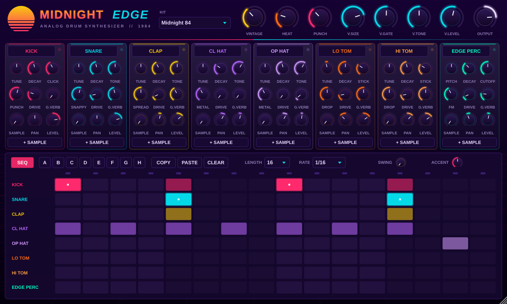

# Midnight Edge

A synthwave / darksynth drum machine VST3 built to sit next to the Midnight 84 synth.
The sound starts from LinnDrum-style drums and pushes them toward the heavy, distorted
hits of Carpenter Brut and GosT. The workflow takes ideas from the Behringer Edge:
a step sequencer, voices you can tweak, and FM metallic percussion.



## Features

- **8 synthesised voices**: Kick, Snare, Clap, Closed Hat, Open Hat (choked by the closed hat),
  Low Tom, High Tom and an Edge-style FM percussion voice.
- **Per voice controls**: Tune, Decay, two character controls (Punch/Click, Snappy, Spread,
  Metal, Drop, FM…), Drive, Gated Verb send, Sample blend, Pan and Level.
- **Layer your own LinnDrum samples**: drag a `.wav/.aif/.flac` onto a voice, or click
  **+ SAMPLE**. The **SAMPLE** knob blends between the synth voice and the sample, and full
  synth plus full sample sit at the middle. The sample follows the voice's Tune, Drive, verb
  and pan, so you can put the synth punch under the Linn character. Right-click the
  sample button to remove the sample.
- **Master bus**:
  - **VINTAGE**: 8-bit mu-law, 28 kHz LinnDrum-style grit.
  - **HEAT**: tape-style saturation into a soft clipper.
  - **PUNCH**: a compressor with a slow attack, so transients get through.
  - **Gated reverb**: Size, Gate time (turn it all the way up to switch the gate off), Tone and Level.
  - **OUTPUT**: final level, with a soft clipper so the output stays at or below 0 dBFS.
- **Edge-style step sequencer**:
  - 8 patterns (A–H), 16 steps and per-step accents.
  - Pattern length from 1 to 16 steps, for polymeters.
  - Rates of 1/8, 1/16, 1/16T and 1/32, plus swing.
  - The sequencer follows the host tempo and transport.
- **5 factory kits**: *Midnight 84*, *Turbo Killer*, *Gated '85*, *Dark Ghost* and *Edge Metal*.
  Choose them from the KIT menu or from FL Studio's preset list.

## Using it in FL Studio

1. Download the **MidnightEdge-Windows-VST3** artifact from the latest *Build* run in
   GitHub Actions (or from a release), and unzip it.
2. Copy the `Midnight Edge.vst3` folder to `C:\Program Files\Common Files\VST3\`.
3. In FL Studio, open *Options → Manage plugins*, click *Find plugins*, then star
   **Midnight Edge** so it shows up in the Channel Rack.

**Two ways to play it:**

- **Built-in sequencer**: leave **SEQ** on and press play in FL. Click a step to turn it on.
  Right-click or shift-click a step to add an accent, and drag to paint steps. The **Pattern**
  parameter can be automated, so you can switch patterns from the playlist with an
  automation clip.
- **Piano roll**: turn **SEQ** off and write notes using the GM drum map:

  | Voice | Notes |
  |---|---|
  | Kick | 35, 36 (C1) |
  | Snare | 38, 40 |
  | Clap | 39 |
  | Closed Hat | 42, 44 |
  | Open Hat | 46 |
  | Low Tom | 41, 43, 45 |
  | High Tom | 47, 48, 50 |
  | Edge Perc | 37, 56, 75 |

  FL Studio's piano roll labels middle C as C5, so the kick (note 36) appears as **C3** in FL.

Click a voice name, either on its strip or in the sequencer, to audition that voice.

## Sound design tips

- **Carpenter Brut kick**: turn PUNCH and DRIVE up on the kick, put HEAT around 50–60%,
  and keep the kick's gated verb at 0.
- **Huge '85 snare**: set the snare's G.VERB to 70–90% and V.GATE to 300–450 ms, with a
  large V.SIZE. Raise the toms' G.VERB as well for Phil Collins-style fills.
- **GosT darkness**: tune the kick, snare and toms down by 3–7 semitones, then add VINTAGE
  and HEAT. *Dark Ghost* is a good starting kit.
- **Linn layer**: load a LinnDrum snare on the SNARE voice and set SAMPLE to about 50%.
  The synth adds weight and the sample adds the familiar crack.

## Building from source

Requirements: CMake 3.22+ and a C++20 compiler (Visual Studio 2022 on Windows, or Xcode
on macOS). JUCE is downloaded automatically.

```sh
cmake -S . -B build -DCMAKE_BUILD_TYPE=Release
cmake --build build --config Release --target MidnightEdge_VST3
```

The plugin is written to `build/MidnightEdge_artefacts/Release/VST3/`. A Standalone
target (`MidnightEdge_Standalone`) is also available, for trying the plugin without a DAW.

### Render test

An offline test renders every voice and kit to WAV and checks for NaNs, silence and
clipping. It also checks that the state round-trips and saves a screenshot of the editor:

```sh
cmake -S . -B build-test -DMIDNIGHT_EDGE_BUILD_TESTS=ON
cmake --build build-test --target MidnightEdgeRenderTest
./build-test/MidnightEdgeRenderTest_artefacts/Release/MidnightEdgeRenderTest render-out
```

Note: no LinnDrum samples are included. Every sound is synthesised, and samples you load
are referenced by their file path, which is saved with your FL project.
